<p align="center">
  
</p>

<p align="center">
  <a href="https://mohamed-osman.com"></a>
  <a href="https://www.linkedin.com/in/mohamed-osman-eg"></a>
  <a href="mailto:imohamedosmann@gmail.com"></a>
  <a href="https://leetcode.com/MoOsman_5/"></a>
</p>

## 👋 About me

I design and build backend systems that have to stay fast as the data grows.

At **ABS Courier** (2024 – 2026) I designed and built the company's logistics platform from scratch, replacing a purchased legacy system. It handles **20M+ shipments a year for 50,000+ users**: 1,000+ staff, 5,000+ business customers, and the consignees tracking their shipments, I led the team of 5 backend engineers behind it, then owned its architecture as Principal Architect.

```ts
const mohamed = {
  role: "Senior Backend Engineer",
  previously: "Principal Architect @ ABS Courier (2026), Backend Team Lead (2024 – 2026)",
  location: "Giza, Egypt 🇪🇬",
  stack: ["TypeScript", "Node.js", "NestJS", "PostgreSQL", "Redis", "Bull", "Docker", "AWS"],
  focus: ["database performance", "queue-based processing", "multi-tenant SaaS"],
  lastShipped: "kicked off the platform's re-architecture into a multi-tenant SaaS",
  alsoShips: ["React", "Next.js", "React Native"],
};
```

## 🏗️ The platform I built at ABS Courier

<p align="center">
  
</p>

| Problem | What I did |
| --- | --- |
| Shipment tables growing every day | Partitioned high-volume tables by date, keeping query times flat as the dataset grew |
| Reporting load hitting the primary DB | Added PostgreSQL read replicas behind PgBouncer and routed lag-tolerant reads off the primary |
| Slow, blocking background work | Moved bulk ingest, WhatsApp notifications and tracking events onto Bull queues with a dedicated worker |
| API latency | Introduced a Redis caching layer, improving response times **~3.7x** |
| Schema changes on live data | Ran zero-downtime migrations on live high-volume tables |
| External integrations | Built the public shipment-tracking and partner-facing APIs |

## 💼 Experience

<p align="center">
  
</p>

<details>
<summary><b>Read it as text</b></summary>

| When | Where | Role | Highlights |
| --- | --- | --- | --- |
| 2026/08 – 2026/10 | **ABS Courier** · Cairo | Principal Architect | Owned the platform's architecture and led its re-architecture into a multi-tenant SaaS: tenant isolation, data boundaries, API versioning |
| 2024/11 – 2026/08 | **ABS Courier** · Cairo | Backend Team Leader | Built the logistics platform from scratch (20M+ shipments/yr), date partitioning, read replicas behind PgBouncer, Bull queues, Redis (~3.7x faster), led 5 engineers |
| 2024/05 – 2024/11 | **ABS Courier** · Cairo | Full Stack Developer | Proposed NestJS + PostgreSQL for the replacement, owned the architecture, took over the backend within 6 months |
| 2024/01 – 2026/09 | **DECI** · Giza | Instructor | Taught coding and robotics to young learners |
| 2023/06 – 2024/05 | **NasNav** · Al Rehab City | Software Developer | React web apps and React Native mobile apps integrated with backend APIs |
| 2022/06 – 2023/06 | **Teqneia ICT** · El Sheikh Zayed | Software Developer | Responsive React.js web apps for client projects |

**Education:** Cairo University, Faculty of Science · Bachelor of Computer Science (2018 – present)
**Awards:** ECPC 2022 · Egyptian Collegiate Programming Contest

</details>

## 🧰 Tech stack

<p align="center">
  
  <br/>
  
</p>

<p align="center"><sub>Also: Bull queues · PgBouncer · OpenTelemetry · Loki · event-driven design · Architecture Decision Records</sub></p>

## 📈 GitHub activity

<p align="center">
  
</p>

<p align="center">
  <picture>
    <source media="(prefers-color-scheme: dark)" srcset="https://raw.githubusercontent.com/MoOsman5/MoOsman5/output/github-snake-dark.svg"/>
    
  </picture>
</p>

<p align="center">
  
</p>
