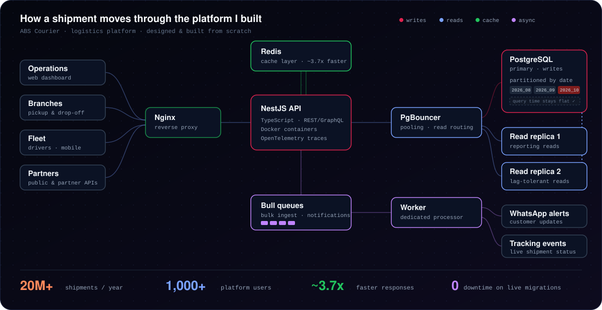

<p align="center">
  
</p>

<p align="center">
  <a href="https://mohamed-osman.com"></a>
  <a href="https://www.linkedin.com/in/mohamed-osman-eg"></a>
  <a href="mailto:imohamedosmann@gmail.com"></a>
  <a href="https://leetcode.com/MoOsman_5/"></a>
</p>

## 👋 About me

I design and build backend systems that have to stay fast as the data grows.

At **ABS Courier** I designed and built the company's logistics platform from scratch, replacing a purchased legacy system. It now handles **20M+ shipments a year for 1,000+ users**, and I lead the team of 5 backend engineers behind it.

```ts
const mohamed = {
  role: "Senior Backend Engineer · Backend Team Lead @ ABS Courier",
  location: "Giza, Egypt 🇪🇬",
  stack: ["TypeScript", "Node.js", "NestJS", "PostgreSQL", "Redis", "Bull", "Docker", "AWS"],
  focus: ["database performance", "queue-based processing", "multi-tenant SaaS"],
  currently: "re-architecting the platform into a multi-tenant SaaS for courier companies",
  alsoShips: ["React", "Next.js", "React Native"],
};
```

## 🏗️ The platform I built

<p align="center">
  
</p>

| Problem | What I did |
| --- | --- |
| Shipment tables growing every day | Partitioned high-volume tables by date, keeping query times flat as the dataset grew |
| Reporting load hitting the primary DB | Added PostgreSQL read replicas behind PgBouncer and routed lag-tolerant reads off the primary |
| Slow, blocking background work | Moved bulk ingest, WhatsApp notifications and tracking events onto Bull queues with a dedicated worker |
| API latency | Introduced a Redis caching layer, improving response times **~3.7x** |
| Schema changes on live data | Ran zero-downtime migrations on live high-volume tables |
| External integrations | Built the public shipment-tracking and partner-facing APIs |

## 🧰 Tech stack

<p align="center">
  
  <br/>
  
</p>

<p align="center"><sub>Also: Bull queues · PgBouncer · OpenTelemetry · Loki · event-driven design · Architecture Decision Records</sub></p>

## 📈 GitHub activity

<p align="center">
  
  
</p>

<p align="center">
  <picture>
    <source media="(prefers-color-scheme: dark)" srcset="https://raw.githubusercontent.com/MoOsman5/MoOsman5/output/github-snake-dark.svg"/>
    
  </picture>
</p>

<p align="center">
  
</p>
